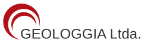

# GeoWedge 3D Pro ⛏️🚇

> **Herramienta Geotécnica 3D para Análisis de Estabilidad de Cuñas Subterráneas, Soporte Óptimo y Efecto Sísmico.**  
> Desarrollado por **Geologgia Ltda** ([geologgia.cl](https://geologgia.cl)).



---

## 🌟 Descripción General

**GeoWedge 3D Pro** es una solución web interactiva y motor en Python creada mediante **ingeniería inversa ética de sala limpia (Clean-Room Implementation)**, inspirada en las funcionalidades clave de herramientas estándar como **Rocscience UnWedge**. 

Permite a ingenieros geotécnicos, geomecánicos y de túneles evaluar de manera instantánea el factor de seguridad (FS) de cuñas inducidas por discontinuidades estructurales (fallas, diaclasas, estratificación) en excavaciones subterráneas civiles y mineras.

---

## 🚀 Características Principales

1. **Perfiles de Excavación Paramétricos**:
   - 🚇 **Herradura Clásica (Horseshoe)**.
   - 🏛️ **Bóveda / Medio Punto Semicircular (Arch)**.
   - ⭕ **Circular / TBM (Túnel Escudo)**.
   - 📦 **Rectangular / Cajón / Caserón Minero**.
   - 🪜 **Piques Verticales (Shafts a 90°)**: cálculo cinemático de cuñas en pared cilíndrica vertical con anillos radiales de sostenimiento.

2. **Escalamiento Dinámico de Cuñas**:
   - Selector continuo del tamaño de cuña (10% a 100%) para modelar tanto cuñas máximas críticas como desprendimientos locales/menores.

3. **Módulo de Sismicidad Pseudoestática ($k_h, k_v$, Azimuth)**:
   - Incorporación de coeficientes sísmicos de diseño conforme a la práctica chilena y andina ($k_h \in [0.10, 0.25]\text{g}$ y $k_v = \pm \frac{1}{2} k_h$).
   - Vector inercial sísmico renderizado en 3D en tiempo real.

4. **Soporte y Fortificación Activa**:
   - **Pernos de anclaje**: Malla transversal/longitudinal, longitud, adherencia y capacidad tensil en MN o kN.
   - **Hormigón Proyectado / Shotcrete**: Espesor $t$, $f'_c$ y resistencia al corte perimetral $\tau$.

5. **Robotito Geotécnico IA**:
   - Sugiere automáticamente en 1-clic tres configuraciones óptimas de sostenimiento para cumplir el Factor de Seguridad objetivo ($FS \ge 1.15$, $1.30$, o $1.50$):
     - **Opción A**: Solo Pernos (optimiza malla y longitud mínima de anclaje).
     - **Opción B**: Solo Shotcrete (calcula espesor mínimo requerido).
     - **Opción C**: Sistema Combinado Óptimo (malla estándar + shotcrete reforzado).

6. **Doble Sistema de Unidades Geomecánicas**:
   - Conmutación directa entre **MPa / MN** y **kPa / kN** con sincronización automática en todos los campos de entrada y tablas de tensiones.

7. **Visualizador 3D Avanzado**:
   - Modos de navegación: Rotación orbital 3D, Pan (traslación del modelo), Zoom con rueda y táctil (*pinch-to-zoom*), y botón de centrado rápido. 100% amigable con iPad y tablets de terreno.

---

## 📂 Estructura del Repositorio

```text
geowedge-3d-pro/
├── index.html            # Simulador interactivo 3D completo (Standalone Web App)
├── unwedge_engine.py     # Motor analítico vectorial en Python (CLI y API)
├── assets/
│   └── logo_geologgia.svg # Logotipo oficial de Geologgia Ltda
├── README.md             # Documentación técnica
└── LICENSE               # Licencia MIT (Open Source)
```

---

## 🛠️ Instalación y Uso

### 1. Simulador Web (Sin instalación)
Simplemente abre `index.html` en cualquier navegador web moderno (Chrome, Edge, Safari, Firefox). Funciona **100% offline** sin servidores externos.

### 2. Motor Geotécnico Python
```bash
# Ejecutar motor de cálculo en consola
python unwedge_engine.py
```

---

## ⚖️ Aspectos Legales y Derechos de Autor

- **Metodología y Algoritmos**: Los fundamentos matemáticos se basan en la **Teoría de Bloques para Macizos Rocosos** publicada abiertamente por **Richard E. Goodman y Gen-Hua Shi (1985)** (*Block Theory and Its Application to Rock Engineering*, Prentice-Hall), así como los principios de equilibrio límite vectorial y análisis pseudoestático.
- **Implementación Limpia**: Todo el código fuente (JavaScript, Canvas 3D y Python) ha sido escrito desde cero de manera original por **Geologgia Ltda**, sin reutilizar ni desensamblar código binario propietario de Rocscience Inc.
- **Marcas Registradas**: *UnWedge* y *Rocscience* son marcas comerciales de Rocscience Inc. Se mencionan en este proyecto con fines meramente comparativos e ilustrativos (*fair use* / uso legítimo de compatibilidad técnica).

---

## 📄 Licencia

Este proyecto está bajo la licencia **MIT License** — puedes usarlo libremente para fines comerciales, académicos o personales.

Desarrollado con dedicación por **Geologgia Ltda** ([Contacto](https://geologgia.cl)).
